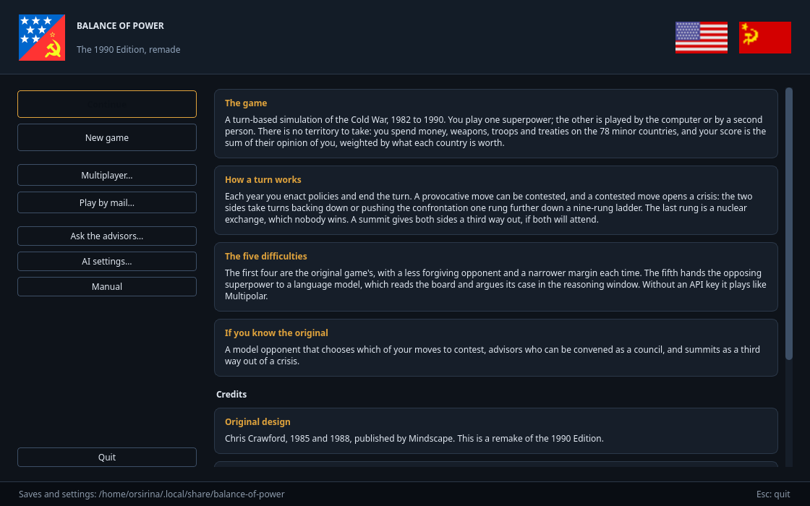
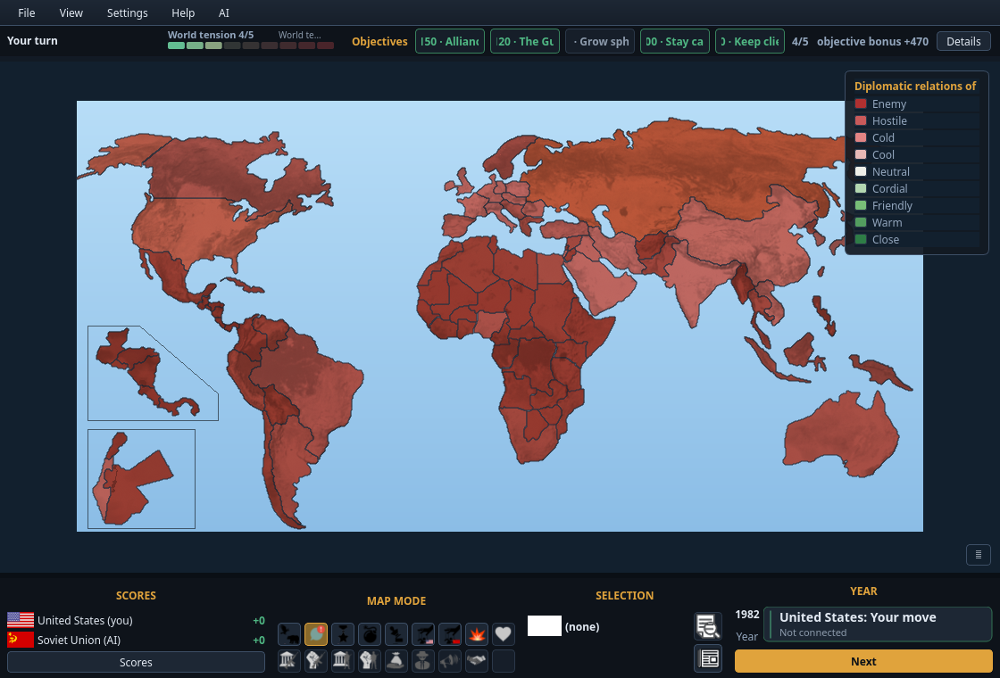
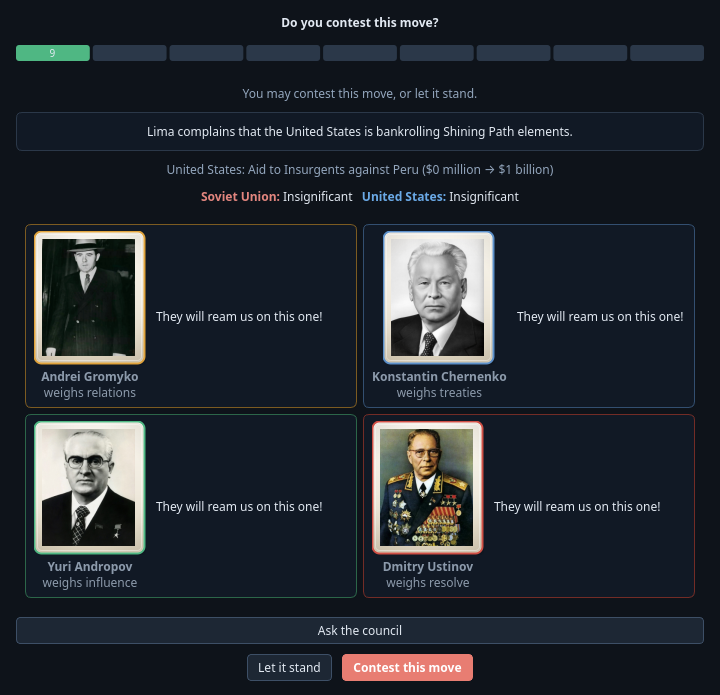
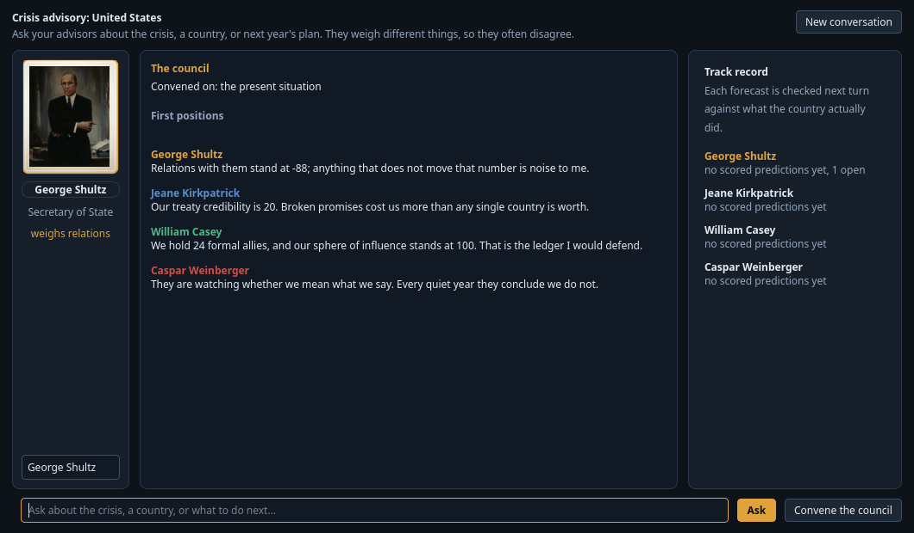

# Баланс сил (Balance of Power)

**[English version — README.md](README.md)**

Пошаговая стратегия о холодной войне, 1982–1990 годы. Вы руководите одной из
двух сверхдержав — США или СССР; другой играет компьютер или второй игрок.
Территорий здесь не захватывают: вы тратите деньги, оружие, войска и договоры,
чтобы 78 малых стран мира относились к вам лучше, особенно самые важные. Очки —
это ваш геополитический престиж. Побеждает тот, чей престиж вырос сильнее.
Ядерная война — проигрыш для обоих.



## Авторы

* **Оригинальная игра:** Крис Кроуфорд (Chris Crawford), *Balance of Power*
  (1985) и *Balance of Power: The 1990 Edition* (1988), издатель Mindscape.
  Исходный код оригинала на Pascal открыт:
  <https://github.com/balance-of-power/bop2-pascal-source>.
* **Порт на Python:** Томаш Цыборский (Tomasz Ciborski), 2020 —
  <https://github.com/tomaszcib/Balance-of-Power-Reviewed-Python->.
* **Эта версия** добавляет противника на основе языковой модели, советников,
  саммиты, промежуточные цели, исторические события, сетевую игру и игру по
  почте, а также много исправлений. Она сделана с помощью ИИ-ассистентов для
  программирования **Claude** (Anthropic) и **DeepSeek**.

Графика — из оригинальной игры. Фотографии советников взяты с Wikimedia Commons
(`img/advisors/ATTRIBUTION.md`), музыка распространяется по лицензии CC BY
(`music/ATTRIBUTION.md`).

## Что нового в этой версии

* **Пять уровней сложности:** Beginner, Intermediate, Expert, Multipolar и
  Adaptive. На уровне Adaptive за противника играет языковая модель через любой
  OpenAI-совместимый API (*AI → AI settings*); без ключа API он играет как
  Multipolar.
* **Советники:** по четыре исторических деятеля с каждой стороны (Шульц,
  Киркпатрик, Кейси, Уайнбергер; Громыко, Черненко, Андропов, Устинов). У них
  разные взгляды, и на совете они спорят друг с другом.
* **Кризисы и саммит:** провокационный ход можно оспорить. Кризис идёт по
  лестнице из девяти ступеней до DEFCON 1, а по ходу кризиса можно предложить
  саммит.
* **Исторические события:** 14 событий от Фолклендской войны до падения
  Берлинской стены меняют мир по ходу игры.
* **Туман войны:** настоящий уровень мировой напряжённости не виден, есть
  только оценка разведки.
* **Цели:** пять постоянных обязательств, которые дают очки, пока выполняются.
* **Сетевая игра:** вдвоём за одним компьютером, по локальной сети или по почте
  (ход — это файл в общей папке).
* **Встроенное руководство:** *Help → Manual*. Интерфейс игры на английском.

## Установка и запуск

Нужны Python 3.8–3.14 (64 бита) и библиотека PyQt5. Права администратора не
нужны. Скачайте репозиторий (*Code → Download ZIP*), распакуйте и запустите
файл для своей системы:

| Система | Файл запуска | Примечание |
|---|---|---|
| Windows | `start-windows.bat` (двойной щелчок) | При первом запуске сам ставит PyQt5. |
| Windows (venv) | `setup-venv-windows.bat` | То же, но в отдельном виртуальном окружении. |
| Linux | `./start-linux.sh` | Если PyQt5 нет, предложит поставить (спросит). |
| macOS | `start-mac.command` (двойной щелчок) | Вызывает `start-linux.sh`. |

Вручную на любой системе:

```bash
python3 -m pip install -r requirements.txt
python3 main.py
```

Подробная инструкция по установке, сети и решению проблем — `USTANOVKA-RU.txt`.
Правила игры для новичков — `PRAVILA-RU.md` и `PRAVILA-RU.pdf`.

## Скриншоты



| Кризис | Совет советников |
|---|---|
|  |  |
