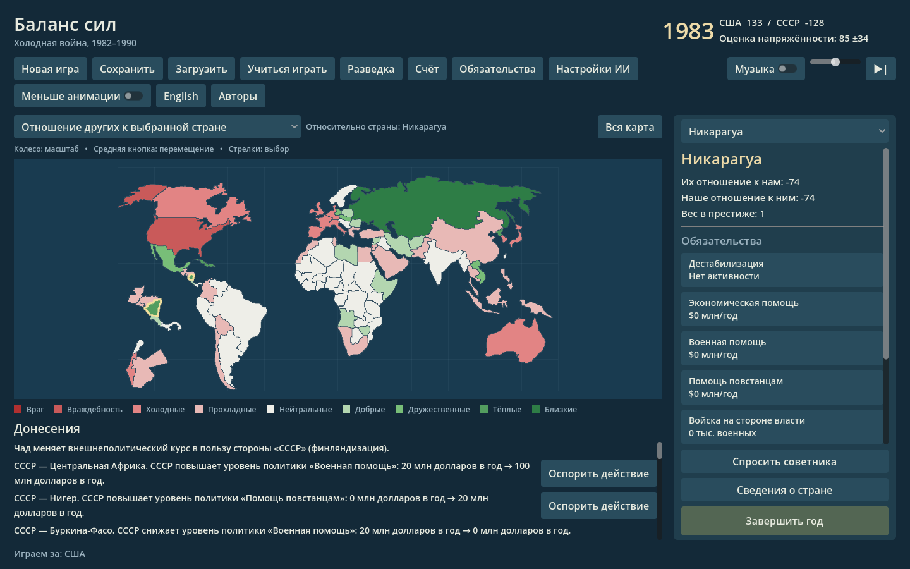

# Godot engine prototype

This playable desktop prototype presents the existing Python rules in Godot 4.7.2. Godot handles the map, controls, animation, sound and localization; Python remains authoritative for policy, crises, yearly simulation and model calls. Keeping the established rules avoids a second simulation drifting from the original. The tradeoff is packaging both runtimes.

Godot is open source under the [MIT license](https://godotengine.org/license/). Linux is the tested platform. Windows and macOS export presets and native build support are included, but their launchers still need execution on those operating systems.

## Standalone Linux build

The generated `dist-godot/BalanceOfPower-linux.tar.gz` contains the exported game, frozen Python launcher, required runtime files and credits. Extract it and run `linux/BalanceOfPower --language ru`. Keep the executable, `bop-game`, its `.pck`, `_internal` and `credits` together. It does not require separately installed Python or Godot.

This development build was made with glibc 2.43. Older Linux distributions may need a build produced on an older compatible host. For reproducible native builds, see [packaging instructions](../packaging/godot/NATIVE-BUILDS.md). Windows and macOS binaries must be built and tested on their respective hosts; export success alone does not establish platform compatibility.

## Running from source

Install Godot 4.7.2 and Python 3. The Godot frontend and its Python backend use the standard library at runtime; PyQt5 is needed for the original Qt application and some asset regeneration workflows, not for the source launcher. The launcher finds `godot` or `godot4` on PATH, the standard macOS app location, or the project's local Linux tool installation. Specify a different executable with `--godot /absolute/path/to/godot` or `BOP_GODOT`.

```sh
python3 tools/run_godot.py --language ru
# Linux: packaging/run-godot.sh --language en
# macOS: packaging/run-godot.command --language ru
```

On Windows, run `packaging\run-godot.bat --language ru` from a command prompt; `py -3` and Godot must be available, or set `BOP_GODOT` to the executable. The launcher imports project assets with a headless editor process before starting the game, so a source checkout does not need a pre-existing `godot/.godot` cache. Godot closes when the game exits; the launcher also shuts down the local bridge.

Use `--language en` or `--language ru` to select a presentation language. The prototype has all 60 original map modes with difficulty restrictions, country reports and history charts, scores and standing objectives, policy controls, news and crises, advisors, AI settings, save/load, a guided tutorial, and music controls. Multiplayer and some established workflows remain in the Qt game.

## Architecture and settings

`EngineBridge` hosts the Python engine in the launcher process. Godot sends JSON commands to a loopback HTTP server (`POST /command`) with a per-launch bearer token. The server returns game state and command results; the Python engine remains responsible for game rules and save data. The launcher stops the server and game together. This local protocol is an implementation interface, not a public remote service.

Normal play reuses the existing Python user directory and configured model settings, including the existing advisor/opponent configuration. Godot presentation preferences are stored separately in Godot's `user://presentation.cfg`. A smoke run uses a temporary Python user directory, removes model credentials and proxy environment variables, and does not configure model clients.

Use **AI settings / Настройки ИИ** inside Godot to configure the endpoint, key, opponent and advisor models, budgets, timeouts and offline mode. Existing keys are never returned to the UI: leaving the masked field empty preserves the saved key; clearing it is explicit. Reading and applying settings do not contact a provider. **Test connection** is an explicit diagnostic request and can incur provider charges. Environment overrides are identified in the dialog.

Level 5 uses the original model opponent and falls back visibly if it is unavailable. Crisis dialogue automatically requests the text model for both challenge directions; a visible loading state separates pending work from the final model or rules-based result. Training, disabled advisors, offline mode, missing configuration and provider failure have distinct localized status messages. Russian fallback advice uses the same verdicts as the game and current visible facts, including the policy, crisis rung and prestige estimate. Replies cannot change the completed mechanical decision. Changing settings invalidates old requests, preventing late replies from replacing newer settings or dialogue.

Advisor dialogs have **Latest answer**, **Conversation**, and **Track record** tabs. Transcripts stay separate by language; each advisor's prediction record is shared across languages. Pending forecasts resolve after the next year, and forecasts, aggregate calibration and bounded recent results survive save/load. The bridge save reserves at most 24 KB for this data, retaining pending forecasts and aggregate results before trimming old transcript text. This record belongs to the campaign; the old Qt application's cumulative memory file is untouched. Advice uses real money/personnel units and labels answers with their request year.

Russian localization covers the new Godot interface, country names, policy steps and limits, news, crisis summaries, tutorial and advisor output. It does not turn the old Qt application into a fully Russian interface.



[Learning session](screenshots/godot-tutorial.png) · [Practice crisis](screenshots/godot-tutorial-crisis.png) · [Policy controls](screenshots/godot-policy.png) · [Crisis](screenshots/godot-crisis.png) · [Advisor](screenshots/godot-advisor.png) · [Conversation](screenshots/godot-advisor-conversation.png) · [Advisor record](screenshots/godot-advisor-record.png) · [History](screenshots/godot-history.png) · [Scores](screenshots/godot-scores.png) · [AI settings](screenshots/godot-settings.png)

## Checks

```sh
python3 tests/test_engine_bridge.py
python3 tests/test_crisis_dialogue.py
python3 tests/test_advisor_facts.py
python3 tests/test_engine_campaigns.py
QT_QPA_PLATFORM=offscreen python3 -m unittest discover -s tests -p 'test_*.py' -q
python3 tools/run_godot.py --headless --smoke-test
```

The Godot smoke run exercises map selection, policy radio controls and Apply, an ordinary crisis, a year transition, save/load, reports and history tabs, AI settings, and the Russian UI. It presses the advisor's Ask button and checks the displayed reply. The learning session includes a prepared offline crisis: the normal rules process one escalation, a concession, the policy reversal and actual prestige loss. Further escalation is disabled within that lesson. Returning restores the exact campaign, RNG stream, conversations and pending crisis; return from training before starting a new game or saving.

A graphical run captures the main screen and additional tutorial, policy, crisis, advisor, reports and settings PNGs with `python3 tools/run_godot.py --smoke-test --language ru --screenshot /absolute/path/screenshot.png`.

Validation on 2026-11-09: all 105 tests in the combined suite pass, including actual headless Godot callback regressions and ten full campaign scenarios (both sides, levels 1–5). Every campaign reaches the configured 1990 ending, saves during a pending crisis, and matches the world and random state of an uninterrupted twin after every command. Level 5 uses the original opponent in explicit offline mode for this campaign matrix; separate local stand-ins cover model transport and reply behavior. The prior development checkout's 192-check LLM suite and historical dialog regression also passed; those historical test files are not restored into this cleaned release tree. The import-isolation test uses a 30-second startup deadline to accommodate loaded build hosts; its Qt-free import and original-engine parity assertions are unchanged.

The graphical smoke run passes, as does the frozen Linux bundle extracted to a path containing spaces and launched from another working directory with `PATH=/nonexistent`. Earlier network smoke and crisis regression checks passed in the prior development checkout. Map report modes 0–57 match the Qt values and colors for every country; trade modes 58–59 read the actual trade tables, correcting the old display path. Tests cover stale replies, secret-free settings, campaign restoration, calibration persistence and difficulty restrictions. No paid providers are contacted by these checks. Windows and macOS Godot client cross-exports succeed; native launcher builds and execution remain unverified on those operating systems.

## Assets and remaining migration

The map is exported from the existing game data by `tools/export_godot_assets.py`; regeneration requires Shapely 2.2. The generated synthesized WAV themes come from `Music.py`. Additional CC0 music credits, source links, and file details are in [music attribution](../godot/assets/music/ATTRIBUTION.md). Advisor photographs have individual public-domain or CC BY terms; retain their [attribution](../godot/assets/advisors/ATTRIBUTION.md) when distributing them.

Further milestones include multiplayer, portable import/export and play-by-mail UI, and native Windows/macOS validation and release packaging. The existing Qt application remains available for those workflows. The local Godot save slot is deliberately separate from the Qt campaign files. A native CI workflow is prepared locally for all three operating systems; see the packaging instructions for its invocation and validation gates.
