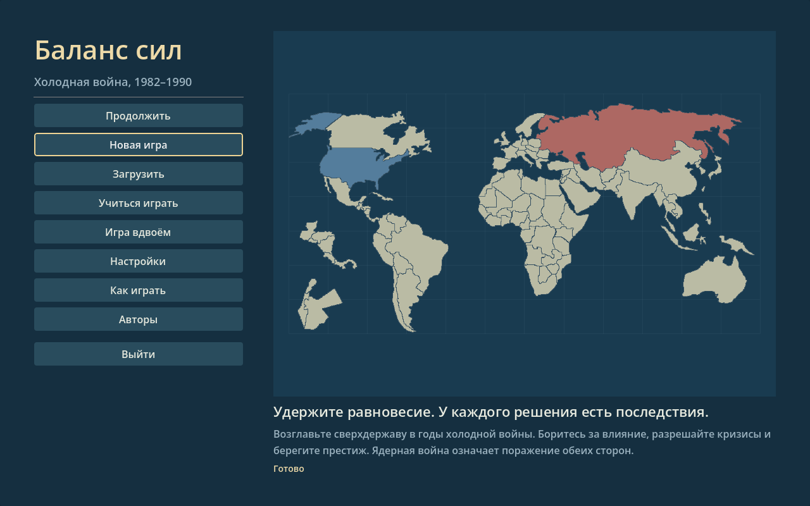
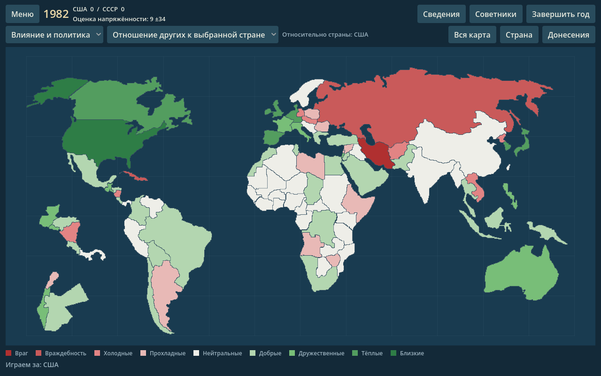

# Godot engine prototype

This playable desktop prototype presents the existing Python rules in Godot 4.7.2. Godot handles the map, controls, animation, sound and localization; Python remains authoritative for policy, crises, yearly simulation and model calls. Keeping the established rules avoids a second simulation drifting from the original. The tradeoff is packaging both runtimes.

Godot is open source under the [MIT license](https://godotengine.org/license/). See the [native packaging instructions](../packaging/godot/NATIVE-BUILDS.md) for build requirements and validation.

## Standalone Linux build

The generated `dist-godot/BalanceOfPower-linux.tar.gz` contains the exported game, frozen Python launcher, required runtime files and credits. Extract it and run `linux/BalanceOfPower --language ru`. Keep the executable, `bop-game`, its `.pck`, `_internal` and `credits` together. It does not require separately installed Python or Godot.

Linux packages require compatible system libraries. For reproducible native builds, see [packaging instructions](../packaging/godot/NATIVE-BUILDS.md). Export success alone does not establish platform compatibility.

## Running from source

Install Godot 4.7.2 and Python 3. The Godot frontend and its Python backend use the standard library at runtime; PyQt5 is needed for the original Qt application and some asset regeneration workflows, not for the source launcher. The launcher finds `godot` or `godot4` on PATH, the standard macOS app location, or the project's local Linux tool installation. Specify a different executable with `--godot /absolute/path/to/godot` or `BOP_GODOT`.

```sh
python3 tools/run_godot.py --language ru
# Linux: packaging/run-godot.sh --language en
# macOS: packaging/run-godot.command --language ru
```

On Windows, run `packaging\run-godot.bat --language ru` from a command prompt; `py -3` and Godot must be available, or set `BOP_GODOT` to the executable. The launcher imports project assets with a headless editor process before starting the game, so a source checkout does not need a pre-existing `godot/.godot` cache. Godot closes when the game exits; the launcher also shuts down the local bridge.

Use `--language en` or `--language ru` to select a presentation language. The start menu offers Continue, New, Load, Learn, Multiplayer, Settings, Help, Credits and Quit. The large map has country, news and tutorial overlays and all 60 original map modes with difficulty restrictions. Reports include scores, objectives, intelligence, opponent history and undo. Named saves support deletion and `.bopg` import/export; undo is available once per turn, including hotseat. The interface also includes policy controls, crises, advisors, AI settings, a guided tutorial and a full English/Russian manual. Presentation options include a colorblind palette, relief, original synthesized cues and music controls.

Multiplayer supports LAN hosting and joining, discovery, chat and reconnection, a teacher byte-forwarding relay, hotseat, and play-by-mail via a shared folder. Godot networking uses `engine-bridge-v1` over BOP1 framing and does not crossplay directly with older Qt clients. The Qt application remains available.

The [interactive map prototype](LIVING_MAP.md) adds original 3D city miniatures with streets and trees, stronger terrain relief, conflict/unrest scenes, clickable event briefings and aid/trade links. The Layers menu keeps these overlays optional. Wheel or +/− zoom, double-click focuses a country, and F restores the world view. Country positions remain schematic until the geographic map is replaced.

**Dispatches / Донесения** opens an interactive briefing over the map. Search the full current news feed, filter policy moves, world events or moves that can be challenged, and select a story to see its country outline, full report, policy values and context. **Show on map** focuses the related country; **Country details** opens its report. Eligible stories retain the existing crisis challenge action. The feed follows the simulation’s importance order, rather than inventing publication times, and preserves the selected story through ordinary updates. Generated reports have no individual timestamps; known historical events show their recorded year.

## Architecture and settings

`EngineBridge` hosts the Python engine in the launcher process. Godot sends JSON commands to a loopback HTTP server (`POST /command`) with a per-launch bearer token. The server returns game state and command results; the Python engine remains responsible for game rules and save data. The launcher stops the server and game together. This local protocol is an implementation interface, not a public remote service. The Python core is retained: there is no measured need to rewrite it. A local benchmark of optimized state/select operations was around 1 ms; this is not a performance guarantee.

Normal play reuses the existing Python user directory and configured model settings, including the existing advisor/opponent configuration. Godot presentation preferences are stored separately in Godot's `user://presentation.cfg`. A smoke run uses a temporary Python user directory, removes model credentials and proxy environment variables, and does not configure model clients.

Use **AI settings / Настройки ИИ** inside Godot to configure the endpoint, key, opponent and advisor models, budgets, timeouts and offline mode. Existing keys are never returned to the UI: leaving the masked field empty preserves the saved key; clearing it is explicit. Reading and applying settings do not contact a provider. **Test connection** is an explicit diagnostic request and can incur provider charges. Environment overrides are identified in the dialog.

Level 5 uses the original model opponent and falls back visibly if it is unavailable. Crisis dialogue automatically requests the text model for both challenge directions; a visible loading state separates pending work from the final model or rules-based result. Training, disabled advisors, offline mode, missing configuration and provider failure have distinct localized status messages. Russian fallback advice uses the same verdicts as the game and current visible facts, including the policy, crisis rung and prestige estimate. Replies cannot change the completed mechanical decision. Changing settings invalidates old requests, preventing late replies from replacing newer settings or dialogue.

Advisor dialogs have **Latest answer**, **Conversation**, and **Track record** tabs. Transcripts stay separate by language; each advisor's prediction record is shared across languages. Pending forecasts resolve after the next year, and forecasts, aggregate calibration and bounded recent results survive save/load. The bridge save reserves at most 24 KB for this data, retaining pending forecasts and aggregate results before trimming old transcript text. This record belongs to the campaign; the old Qt application's cumulative memory file is untouched. Advice uses real money/personnel units and labels answers with their request year.

Russian localization covers the new Godot interface, country names, policy steps and limits, news, crisis summaries, tutorial and advisor output. It does not turn the old Qt application into a fully Russian interface.





[News briefing](screenshots/godot-news-feed.png) · [Learning session](screenshots/godot-tutorial.png) · [Practice crisis](screenshots/godot-tutorial-crisis.png) · [Policy controls](screenshots/godot-policy.png) · [Crisis](screenshots/godot-crisis.png) · [Advisor](screenshots/godot-advisor.png) · [Conversation](screenshots/godot-advisor-conversation.png) · [Advisor record](screenshots/godot-advisor-record.png) · [History](screenshots/godot-history.png) · [Scores](screenshots/godot-scores.png) · [AI settings](screenshots/godot-settings.png)

## Checks

```sh
python3 tests/test_engine_bridge.py
python3 tests/test_crisis_dialogue.py
python3 tests/test_advisor_facts.py
python3 tests/test_engine_campaigns.py
QT_QPA_PLATFORM=offscreen python3 -m unittest discover -s tests -p 'test_*.py' -q
python3 tools/run_godot.py --headless --smoke-test
```

The Godot smoke run uses the actual start-menu buttons and exercises named saves, portable export/import, hotseat restoration, LAN hosting, shared-folder move submission, map selection, policy radio controls and Apply, an ordinary crisis, a year transition, save/load, reports and history tabs, AI settings, and the Russian UI. It presses the advisor's Ask button and checks the displayed reply. The learning session includes a prepared offline crisis: the normal rules process one escalation, a concession, the policy reversal and actual prestige loss. Further escalation is disabled within that lesson. Returning restores the exact campaign, RNG stream, conversations and pending crisis; return from training before starting a new game or saving.

A graphical run captures the main screen and additional tutorial, policy, crisis, advisor, reports and settings PNGs with `python3 tools/run_godot.py --smoke-test --language ru --screenshot /absolute/path/screenshot.png`.

Validation on 2026-11-10: all 144 tests in the combined local suite pass. These include ten full 1982–1990 campaign scenarios (both sides, levels 1–5), exact continuation after saving during a crisis, save/import/undo workflows, real two-service multiplayer, relay and reconnect, shared-folder turns, and Godot request, menu, interactive news and map regressions. The suite uses explicit offline mode or local model stand-ins, without paid provider calls. Targeted Godot tests were rerun after the final menu fixes.

Graphical source smoke runs pass at 1280×800 and 1024×720. Normal UI callbacks also exercise new campaign, named save, hotseat and session reopening. The map occupies about 78% of the logical viewport with drawers closed. Map report modes 0–57 match the Qt values and colors for every country; trade modes 58–59 read the actual trade tables. The import-isolation check verifies that the backend needs no Qt runtime.

Native Windows, Linux and Intel macOS build results are tracked in [PR #1 checks](https://github.com/or-sirina/balance-of-power/pull/1/checks). Automated headless checks do not replace interactive testing on target desktops.

## Assets and remaining migration

The map is exported from the existing game data by `tools/export_godot_assets.py`; regeneration requires Shapely 2.2. Relief, palette and synthesized cue provenance is documented in [asset attribution](../godot/assets/ATTRIBUTION.md). The generated synthesized WAV themes come from `Music.py`. Additional CC0 music credits, source links, and file details are in [music attribution](../godot/assets/music/ATTRIBUTION.md). Advisor photographs have individual public-domain or CC BY terms; retain their [attribution](../godot/assets/advisors/ATTRIBUTION.md) when distributing them.

Remaining work includes interactive testing on target desktops, native Apple Silicon packaging, and macOS signing and notarization. Godot saves are separate from Qt campaign files.
