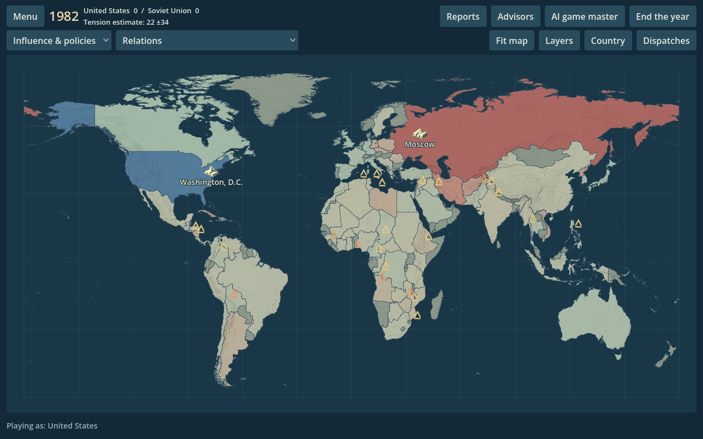
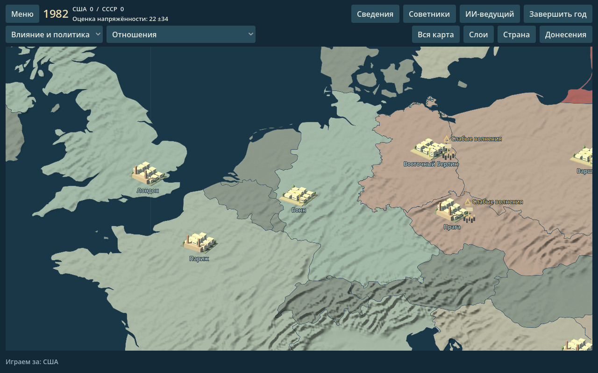

# Interactive geographic map

The Godot map now uses a continuous **1982 geographic reconstruction**, with no enlarged country insets. All 80 simulation identities remain selectable. The map restores the USSR, Yugoslavia, Czechoslovakia, Sudan and Ethiopia; divides Germany and the two Yemens; and represents West Berlin as an enclave. The original Qt map and simulation rules are unchanged.





## Controls

- Wheel or +/−: zoom around the pointer or view center, up to 24×. Middle drag: pan.
- Double-click a country, select it in the Country list, or use a dispatch's Show on map action to focus its government seat. F or Fit map restores the world view.
- Click a city to open country details. Click an event to show its security assessment and related news.
- Layers control city miniatures, terrain, events, labels and policy connections. Connections start hidden; selecting a country isolates its links.
- Click a connection to inspect the existing policy amount and open its target country.

Country polygons retain islands, enclaves and holes. Pacific-edge fragments stay at their real longitudes. Grey territories are outside the 80-country simulation; they cannot receive policies. This color does not mean political neutrality.

## Cities and events

City miniatures now sit at geographic government-seat anchors and have English/Russian city names. Period seats include Bonn, East Berlin, Lagos, Rangoon, Abidjan and Dar es Salaam. Pretoria marks South Africa's executive seat. Coastal anchors may move less than one logical map pixel onto generalized land; metadata retains the original geographic coordinates. Upper Volta becomes Burkina Faso in the Godot country labels from 1984.

The reusable miniature buildings, streets and trees remain original illustrative models. They do not reconstruct individual real buildings. Conflicts, insurgencies, coups and revolutions describe whole countries; their nearby capital marker does not identify a particular battle or demonstration. Aid/trade curves represent policy relationships, not roads or supply routes. Real road networks and province-level warfare are separate future features.

`EngineBridge/map_scene.py` supplies detached, read-only facts. Government stability and insurgency use the original rules and thresholds. Coup/revolution flags describe the current turn. Historical encyclopedia riot counts do not become live events, and unannounced opponent orders are excluded from policy links. Detail zoom reveals minor unrest and multiple events; Reduced motion disables animated smoke.

## Geography, licensing and limits

The reference date is **1 January 1982**. Boundaries remain this scenario's baseline during the campaign; there is no automatic redraw for later unifications or changing military control. [Historical conventions and sources](GEOGRAPHY_1982.md) explain gameplay associations, occupation and disputed territory.

The source is public-domain Natural Earth vector v5.1.2, with original historical union/split processing. Berlin linework is official open data under Datenlizenz Deutschland Zero 2.0. The Yemen division is a generalized factual trace from US government charts. Source URLs, licenses, hashes and reproducible preparation scripts are retained in [data/geography](../data/geography/README.md). No CShapes data or HOI4 assets are included.

This is a generalized historical reconstruction, not a surveyed boundary atlas. The current Länder approximate the former German frontier; small 1988 Berlin exchanges are not reversed. Yemen's historically undefined northeastern frontier uses a documented drawing convention, and its outer desert border retains modern source geometry. Small modern coastline/border differences remain. These limitations are explicit rather than presenting modern geometry as an exact historical legal boundary.

The atlas uses a continuous equirectangular projection, longitude −180…180 and latitude −60…85, with a 36.336° standard parallel. Polar areas outside the playable countries are cropped. Geometry is projected once; shared border coordinates are retained rather than independently simplifying neighboring countries.

## Terrain and regeneration

The old relief image has been replaced by **Natural Earth 1:50m Shaded Relief Basic v3.2.0**, derived from SRTM Plus elevation data and distributed in the public domain. It is cropped/projected to the same atlas bounds, sampled with mipmaps, and masked to the geographic land triangles. This is modern terrain shading, not a measurement of elevation in 1982 or a terrain simulation.

Build-time dependencies: `shapely==2.2.0` and `pillow==12.3.0`; neither is required by the running Godot/Python game.

```sh
python tools/prepare_geography_sources.py       # fetch/check pinned Natural Earth inputs
python tools/prepare_historical_overrides.py    # rebuild from vendored linework and factual trace
python tools/export_geographic_map.py           # rebuild map.json and map_metadata.json
python tools/export_geographic_terrain.py --download  # fetch/check pinned relief archive
# When only geometry changes:
python tools/export_terrain_mask.py
```

The source-preparation download is optional; compact verified vectors are vendored. Terrain regeneration can instead use `--source-archive /path/to/SR_50M.zip`. Normal packaging uses committed assets and does not download geography. `tools/export_godot_assets.py` delegates to the geographic exporter, so it cannot restore the old inset geometry inadvertently.

Original city miniatures are baked with `godot/scripts/city_model_baker.gd`; see [model instructions](../godot/assets/cities/README.md). The visual reference remains layered terrain and readable city/event details, not copied artwork from another game.

## Validation

Geometry tests check all 80 IDs, historic city probes, Berlin and Yemen divisions, valid holes/triangles, shared-border overlap and total land coverage. Raster checks verify independently known land/water locations and provenance hashes. Real Godot input tests select every modeled country from its mesh, exclude neutral land and holes, check both date-line edges, and verify capital focus and fit bounds. Existing tests cover city/event/connection picking, news actions, English/Russian briefings, reduced motion, campaigns and multiplayer.

Graphical inspection covers English/Russian world and detail views at 1280 and 1024 widths. Use a separate build directory while another version is running, for example `python tools/build_godot.py --platform linux --output-root dist-godot-geography`.
