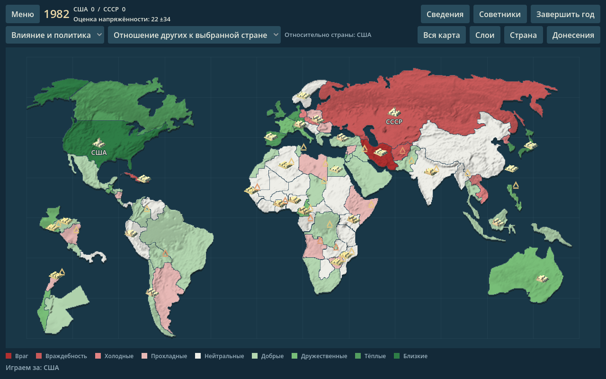
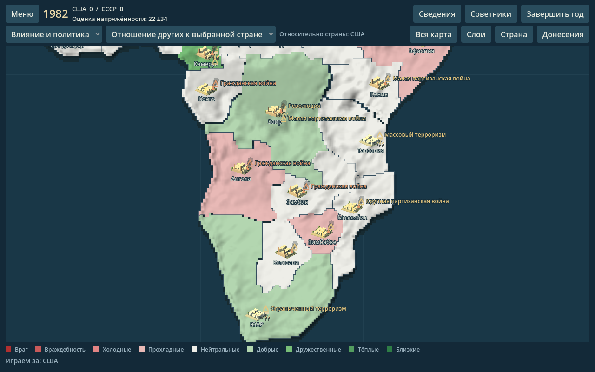

# Interactive map prototype

The Godot map now combines the original country geometry and terrain relief with original 3D city miniatures, streets, trees and country-level event scenes. It retains every map mode, country policy and simulation rule. The visual reference is the layered terrain, city silhouettes and readable zoom levels in [HOI4's map presentation](https://forum.paradoxplaza.com/forum/threads/hoiiv-developer-diary-11-map-graphics-no-counters-discussion.814718/); no assets from that game are included.

## Controls

- Wheel or +/−: zoom around the pointer or view center. Middle drag: pan.
- Double-click a country: focus it. F or Whole map: reset.
- Click a city: open its country details. Click an event: show its security assessment and relevant news.
- Layers: toggle city miniatures/streets, terrain, event markers, labels and aid/trade connections. Connections start hidden to keep the world view readable; select a country to isolate its links.
- Click a connection: inspect the exact existing policy amount and open the target country.

The world view highlights civil wars, major insurgencies, coups and revolutions. Zooming in or focusing a country reveals minor unrest and multiple events. Selected or hovered conflict smoke drifts gently at detail zoom; Reduced motion disables that movement. Rendering updates are throttled to 12 fps for this foreground effect; the simulation is unaffected.

## What the map represents

`EngineBridge/map_scene.py` returns detached read-only facts. Insurgency and government stability use the original country getters and thresholds. Coup/revolution flags describe the current turn and reset during the next country-development pass. Historical encyclopedia riot counts never become live events. Only the player's policy rows become links, keeping unannounced opponent plans out of the overlay.

The rules remain country-level. City positions are schematic interior anchors, not capitals or precise battle/protest locations. City variants illustrate architecture; they do not claim real factories, ports or local economies. The small streets are visual detail. The curved aid/trade lines represent policy relationships, not roads, supply paths or moving units. The briefings identify this distinction.

## Models and regeneration

Six original city miniatures use Godot 3D meshes, an orthographic camera, directional lighting, shadows, streets and trees. They are baked to transparent textures for fast display on the map; the runtime does not maintain dozens of live 3D viewports. The reusable 3D baker is `godot/scripts/city_model_baker.gd`; instructions are in `godot/assets/cities/README.md`.

The terrain shader shades the existing relief image and masks it to the existing polygons. Regenerate the mask with `python3 tools/export_terrain_mask.py` after changing map geometry; this build-time tool requires Pillow. No additional geographic precision is implied by the shading.

## Final-map direction

This is a 2.5D presentation prototype. The original map still enlarges some countries into separate insets and has coarse coastlines. A continuous geographic world is the recommended next foundation for a detailed HOI4-inspired landscape, with geographically positioned cities, road corridors, rivers, forests and more varied models.

[Natural Earth](https://www.naturalearthdata.com/about/terms-of-use/) supplies public-domain country/admin boundaries and terrain data. A future exporter should preserve all 80 simulation IDs, explicitly reconstruct 1982 groupings such as the USSR, Yugoslavia and Czechoslovakia, handle East/West Germany and Berlin, and display unmodeled countries neutrally. Modern boundaries alone must not be labeled an accurate 1982 map. [CShapes](https://icr.ethz.ch/data/cshapes/) supplies historical geometry but uses CC BY-NC-SA terms; it is not embedded in this prototype.

## Validation

`tests/test_map_scene.py` checks actual-world data, exact insurgency thresholds, read-only world/RNG invariants and hidden-opponent policy exclusion. Seed 27 naturally produces all five event families for isolated visual QA. `tests/test_map_scene_ui.py` exercises actual Godot drawing/input, city/event/route picking, zoom anchoring, layer hiding, reduced motion and English/Russian briefings. The existing campaign, multiplayer and desktop smoke suites remain applicable.

Local validation: 137 tests pass; real source rendering and marker briefings were inspected at 1280×800 and 1024×768. Build into a separate directory if another game copy is running, for example `python3 tools/build_godot.py --platform linux --output-root dist-godot-map`.
